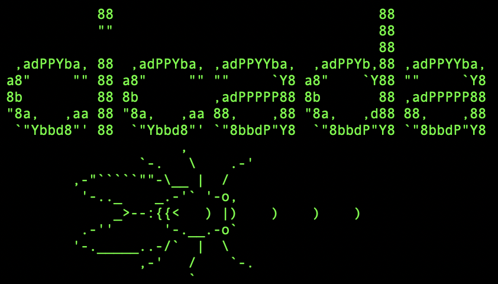
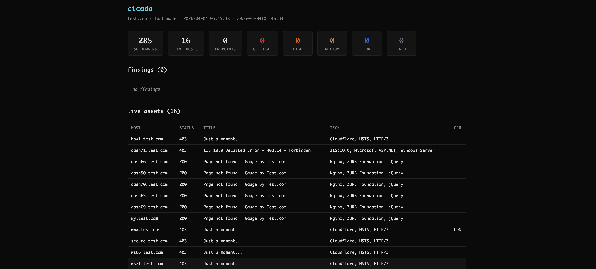
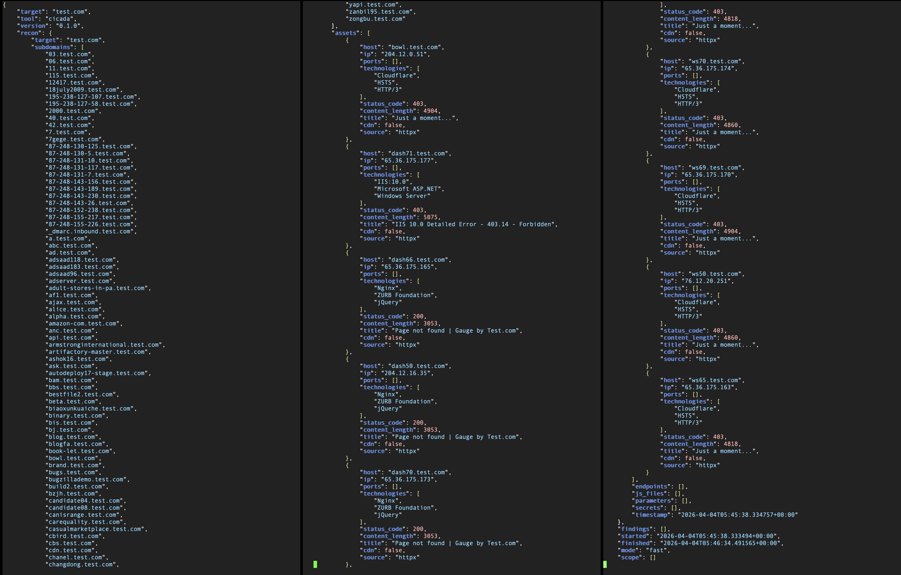

# Cicada

Bug bounty machine. Not a replacement for your brain. Cicada runs the tedious parts of the recon → probe → report pipeline so you can focus on the stuff that actually requires thinking. It orchestrates proven tools (subfinder, httpx, nuclei, katana, ffuf), correlates their output, and generates reports you can actually use; including HackerOne submission templates.

<p align="center"></p>

### It does **not** find bugs for you. It surfaces the attack surface and flags potential issues.

You still have to verify, understand, and responsibly report what it finds. If you're copy-pasting AI-generated reports into H1 without reading them, you're going to have a bad time. Don't be that person.

## Run
**Requirements**

```
Python 3.10+
Go
```

```
go install github.com/projectdiscovery/subfinder/v2/cmd/subfinder@latest
go install github.com/projectdiscovery/httpx/cmd/httpx@latest
go install github.com/projectdiscovery/nuclei/v3/cmd/nuclei@latest
go install github.com/projectdiscovery/katana/cmd/katana@latest
go install github.com/ffuf/ffuf/v2@latest
```

**Ensure Go binaries are in your PATH:**

```
export PATH=$PATH:$(go env GOPATH)/bin
```

**Verify**

```
python3 cicada.py check
```

This tells you what's installed, what's missing, and how to fix it.<br><br>*subfinder, httpx, and nuclei are required; katana and ffuf are optional but you want them for deep mode.*

## Usage
```
python3 cicada.py scan example.com                    # Normal scan
python3 cicada.py scan example.com --fast             # Quick, critical/high only
python3 cicada.py scan example.com --deep             # Full depth, go make coffee
python3 cicada.py scan example.com --tymbal recon.json  # Ingest tymbal data first
python3 cicada.py scan example.com --scope targets.txt  # Multi-target from scope file
python3 cicada.py scan example.com --deep --h1          # Deep scan + h1 report templates
```

You can also skip the `scan` subcommand entirely:

```
python3 cicada.py example.com
python3 cicada.py example.com --deep
```

If you run it with no arguments at all, it drops into interactive mode and asks you what to do.

### Scan Modes

| Mode | What Happens | Time |
|------|-------------|------|
| --fast | subdomain enum → httpx probe → nuclei (critical/high only) | ~2 min |
| normal | subdomain enum → httpx → endpoint discovery → nuclei → security checks | ~10 min |
| --deep | everything above + JS analysis + fuzzing + secret detection | ~30+ min |

### Decoder

```
python3 cicada.py decode --auto 'aGVsbG8gd29ybGQ='    # Auto-detect encoding
python3 cicada.py decode --jwt 'eyJhbGci...'           # Crack open a JWT
python3 cicada.py decode --b64e 'encode this'          # Base64 encode
python3 cicada.py decode --hexd '68656c6c6f'           # Hex decode
```

### Log Analysis

```
python3 cicada.py analyze scan.log
```

Finds encoded strings (base64, hex, URL, JWTs) buried in log files and decodes them. Useful for reviewing scan output manually.

### Scope Files
Cicada accepts scope in multiple formats:
- **Plain text** — one domain per line, `#` comments ignored
- **H1 CSV** — exported directly from HackerOne program scope
- **JSON** — array of targets or object with `targets`/`scope`/`assets` key

```
python3 cicada.py scan primary.com --scope h1_scope.csv
```

## Output
Each scan drops three files in your current directory:

<p align="center"><p><br>
<p align="center"></p>

1. **HTML report** — self-contained, dark themed, findings sorted by severity with evidence blocks. Open it in a browser.
2. **JSON data** — full structured output. Feed it back into Cicada, share it with Tymbal, or parse it yourself.
3. **H1 templates** (with `--h1` flag) — markdown files with pre-filled HackerOne report structure for each medium+ finding. Steps to reproduce, impact assessment, evidence — all there. **Review and edit these before submitting.** They're a starting point, not a finished report.

## Tymbal, BTW
[Tymbal](https://github.com/zblauser/tymbal) is Cicada's little sidekick. It's a POSIX shell script that functions as a standalone or alongside Cicada. It runs on anything; Alpine, iSH on an iPhone, a Raspberry Pi, a toaster running busybox. Zero dependencies beyond basic Unix tools. <br>

The workflow: run Tymbal from wherever you are for quick recon, then feed the JSON into Cicada at home for deep analysis.

```
# Wherever you've got Tymbal
sh tymbal.sh -m deep example.com

# On your workstation
python3 cicada.py scan example.com --tymbal tymbal_example_20260402.json
```

They share the same JSON schema so data merges cleanly (subdomains, assets, findings), all deduped.<br><br>
*For anyone curious: tymbals are the organs cicadas use to produce sound.*

## A Note on AI and Bug Bounties [Read Before Using This Tool]
Cicada generates report templates. It does not generate valid bug reports. There is a difference. Every finding needs manual verification. Every report needs a human who understands what they're submitting and why it matters. The H1 templates are scaffolding; they save you formatting time, not thinking time. Programs are increasingly flagging and rejecting low-effort AI-generated reports. Submitting unverified automated output wastes triager time, damages your reputation, and makes life harder for every other researcher. The "Potential Vulnerabilities" section of a Cicada report means **potential**; as in, go check if it's real **yourself**.
Use Cicada to find the surface. Use your brain to find the bug. Use the templates to save time writing it up.

## Changelog

### v0.1.0 (Latest)
- Complete architectural rewrite from v0.0.2.
- Pipeline-based: recon → probe → report, not a bag of subprocess wrappers
- Shared JSON schema with [Tymbal](https://github.com/zblauser/tymbal) for cross-device or constrainted workflows
- Single-file HTML reports (dark themed, self-contained, not hideous)
- Auto-generated H1 report templates for medium+ severity findings
- JS file analysis for secrets, API keys, internal URLs
- CORS misconfiguration detection, header analysis, open redirect checks
- Proper tool orchestration with timeouts, JSON parsing, dedup
- Decoder module with JWT support and log analysis
- Scope file support (H1 CSV, JSON, plain text)
- Works on macOS and Linux. No Kali required.

<details>
<summary><br>Previous Versions</b></summary>

***v0.0.2***
- Decode (or encode for offense) base64, hex, and URL content found in logs using --decodeall arg
- Running the program will greet you with an ASCII logo and listed [Mode] [Fast], [Normal], [Deep], [Custom], [Help]
- Added shorthand options to some of the arguments
- Custom word lists can be used for fuzzing in ffuf using -w PATH or --wordlist PATH
- If no wordlist is selected it will automatically search typical SecLists paths
- Additionally, you alter the path or add your own in cicada.py
Scan, decode, and fuzz logs should all be written to a single .log file

***v0.0.1***
- Designed to meet my personal testing needs
- Scanning via nuclei
- Fuzzing via ffuf (automatic '/FUZZ' handling)
- Base64 & URL encode/decoding
- Log-based analysis
</details>

## Contributing

If you share the belief that simplicity empowers creativity, feel free to contribute.

#### Contribution is welcome in the form of:
- Forking this repo
- Submiting a Pull Request
- Bug reports and feature requests

Please ensure your code follows the existing style.

## Thank you for your attention.
If you hit any issues, feel free to open an issue on GitHub.
Pull requests, suggestions, or even thoughtful discussions are welcome.


